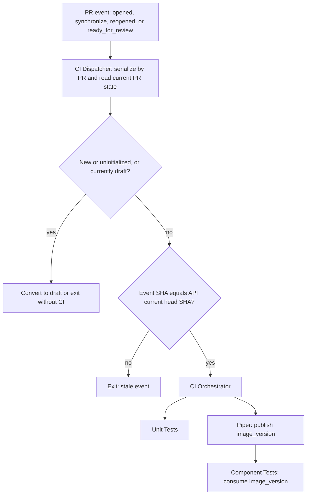

# CI Dispatcher Validation

This pull request validates the draft-gate dispatcher and its race protection.

The required automatic checks are `Run CI / unit-tests / Unit Tests`,
`Run CI / piper / Piper`, and
`Run CI / piper / component-tests / Component Tests`.

Covered cases:

- Opening this PR converts it to draft and does not dispatch CI.
- Marking the drafted PR ready for review dispatches the reusable CI topology.
- Unit Tests and Piper run in parallel; Component Tests starts only after Piper
  publishes `image_version`.
- A label change does not trigger CI because the dispatcher has no `labeled`
  trigger.
- Two rapid commits create queued `synchronize` events. The dispatcher reads
  the API head SHA and exits the outdated event before it can dispatch CI.
- The latest commit receives only the three required nested reusable-workflow
  checks. No report jobs or Component Tests commit status are created.
- Draft PRs never dispatch CI; subsequent ready-for-review and synchronize
  events on a previously drafted ready PR do dispatch it.
- Merge-queue validation runs Unit Tests on the synthetic merge commit and
  publishes the same three required nested check names as successful bypasses.

Race validation revision one.
